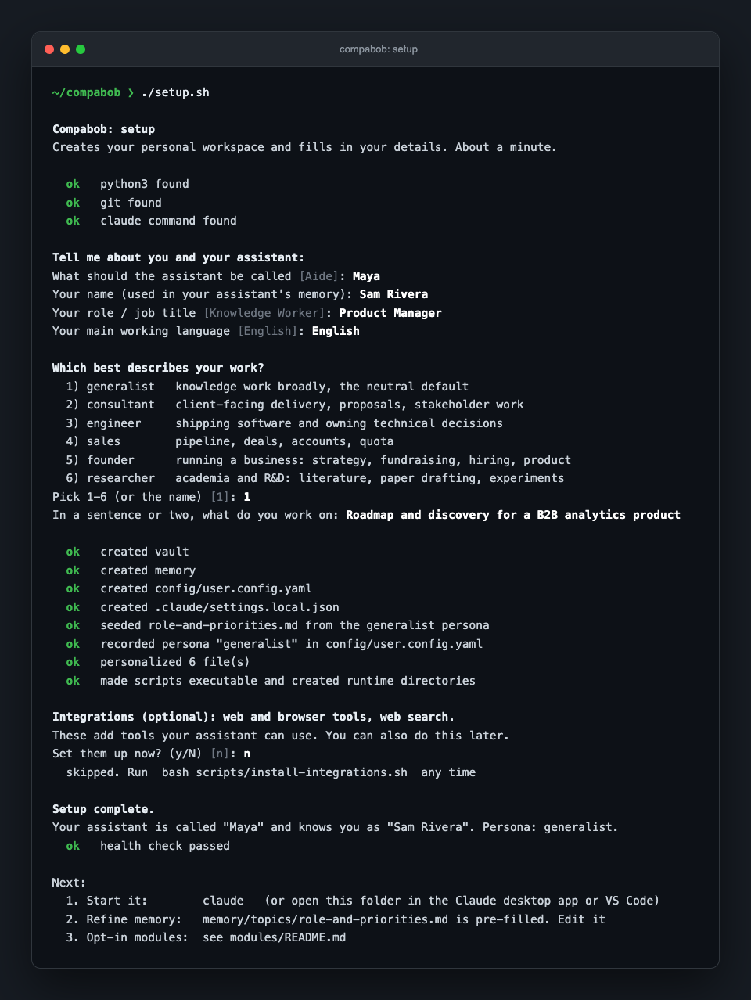

# Compabob

[English](README.md) | [Español](docs/i18n/README.es.md)

[](https://github.com/chacosoldier/compabob/actions/workflows/smoke.yml)
[](LICENSE)
[](https://github.com/chacosoldier/compabob/stargazers)
[](https://github.com/chacosoldier/compabob/commits/main)

**A ready-made AI work assistant built on [Claude Code](https://code.claude.com/docs).** Download it, answer a few questions, and you have an assistant that knows your role, remembers what you tell it, keeps your notes in a knowledge base it can search, and never sends anything without your sign-off. No programming needed: if you can install an app and copy a link, you can set this up.



## What you need

- **A paid Claude plan: Pro or Max.** The free claude.ai plan does not include Claude Code. See [claude.com/pricing](https://claude.com/pricing). Compabob itself is free and has no account of its own.
- **A Mac or a Linux computer.** Windows works through WSL, see [Windows](#windows).
- **About 15 minutes the first time**, most of it waiting for downloads.

## Choose how you want to use it

Claude Code runs in three places. Compabob works the same in all of them. Pick one:

| Path | Best for | Terminal needed? |
|------|----------|------------------|
| [A. Claude desktop app](#path-a-the-claude-desktop-app) | Most people. You may already have the app. | No |
| [B. VS Code](#path-b-vs-code) | People who like several conversations side by side, or who want to see and edit the notes in one window. | No |
| [C. Terminal](#path-c-the-terminal) | People comfortable typing commands. | Yes |

Every path has the same four stages: **install Claude Code, get the Compabob folder, run setup, start talking.**

### Path A: the Claude desktop app

1. **Install the app.** Download Claude for [Mac](https://claude.ai/api/desktop/darwin/universal/dmg/latest/redirect) or [Windows](https://claude.ai/api/desktop/win32/x64/setup/latest/redirect), install it, open it, and sign in with your Pro or Max account. Claude Code lives in the **Code** tab at the top of the app's sidebar. Nothing else to install.
2. **Get the Compabob folder.** In the Code tab, click the project folder control under the prompt box, choose **Open folder…**, and pick your home folder (the one with your name, where Documents and Downloads live). Then type:

   > Download https://github.com/chacosoldier/compabob into a new folder called compabob here, using git clone.

   Claude asks permission to run the command: choose **Allow**. On a Mac that has never used developer tools, a window may pop up offering to install the "command line developer tools". Click **Install**, wait for it to finish (a few minutes), then ask Claude to try again.

   _No git? Download a ZIP instead: on the [GitHub page](https://github.com/chacosoldier/compabob) click the green **Code** button, then **Download ZIP**, unzip it, rename the folder to `compabob` and move it into your home folder. Everything works, but a ZIP copy cannot pull updates later._
3. **Open the folder and run setup.** Click the project folder control again, choose **Open folder…**, and pick the new `compabob` folder. Then type `/setup` and press Enter. Your assistant asks a few questions right in the chat (its name, your name, your role, your language, the kind of work you do). Answer in plain words. One permission box appears for the setup script: choose **Allow**.
4. **Start talking.** Your assistant introduces itself by its new name and suggests a first task. From the next session on, it loads its memory automatically.

**Coming back tomorrow:** open the Claude app, go to the Code tab, and pick a session in the `compabob` folder from the sidebar, or start a new one there.

### Path B: VS Code

1. **Install VS Code and the extension.** Download [VS Code](https://code.visualstudio.com) and open it. Press `Cmd+Shift+X` (Mac) or `Ctrl+Shift+X` (Linux), search for **Claude Code** (publisher: Anthropic), and click **Install**. The extension includes Claude Code itself.
2. **Get the Compabob folder.** Press `Cmd+Shift+P` (Mac) or `Ctrl+Shift+P` (Linux) to open the Command Palette, type **Git: Clone**, press Enter, and paste `https://github.com/chacosoldier/compabob.git`. Choose your home folder as the location, then click **Open** when VS Code offers to open the cloned folder. If VS Code says git is missing, accept its offer to install it (on a Mac: the "command line developer tools"), then repeat this step.
3. **Open Claude and run setup.** Click **✻ Claude Code** in the bottom-right corner of the window (or the Spark icon in the left sidebar). The first time, click **Sign in** and finish in your browser. Then type `/setup` and press Enter, answer the questions, and choose **Allow** on the one permission box for the setup script.
4. **Start talking.** Your assistant introduces itself by its new name and suggests a first task. From the next conversation on, it loads its memory automatically.

**Coming back tomorrow:** open VS Code. It reopens the `compabob` folder; if not, use **File > Open Recent**. Click **✻ Claude Code** to continue.

Tip: in VS Code you can also open `vault/` in the file list on the left and read or edit your notes next to the conversation.

### Path C: the terminal

Every step: paste the command, press Enter, wait for it to finish.

1. **Open the Terminal.** On a Mac press `Cmd + Space`, type `Terminal`, press Enter.
2. **Install Homebrew** (it installs the other tools). Your Mac account must be an administrator.

   ```bash
   /bin/bash -c "$(curl -fsSL https://raw.githubusercontent.com/Homebrew/install/HEAD/install.sh)"
   ```

   It asks for your Mac password (nothing appears as you type, that is normal). When it finishes, it prints "Next steps" with two lines to run so your terminal can find Homebrew. On most Macs they are these:

   ```bash
   echo 'eval "$(/opt/homebrew/bin/brew shellenv)"' >> ~/.zprofile
   eval "$(/opt/homebrew/bin/brew shellenv)"
   ```

3. **Install the tools Compabob uses.**

   ```bash
   brew install git python uv node
   ```

4. **Install Claude Code.**

   ```bash
   curl -fsSL https://claude.ai/install.sh | bash
   ```

   If the next step says `claude: command not found`, close the Terminal window, open a new one, and try again. The [official install guide](https://code.claude.com/docs/en/setup) covers anything else.
5. **Download Compabob into your home folder.**

   ```bash
   cd ~
   git clone https://github.com/chacosoldier/compabob.git
   cd ~/compabob
   ```

6. **Run setup.** It asks seven short questions. Press Enter to accept the suggestion in brackets.

   ```bash
   ./setup.sh
   ```

7. **Start your assistant.**

   ```bash
   claude
   ```

   The first time, it opens your browser to sign in. If the browser does not open, press `c` to copy the link and paste it into your browser.

**Coming back tomorrow:** open the Terminal and run `cd ~/compabob`, then `claude` (a new conversation, with memory loaded) or `claude --continue` (pick up the last conversation).

### Linux

Skip Homebrew. Install the tools with your package manager, then follow Path C from step 4 (or Path B, which works the same on Linux):

- Ubuntu, Debian: `sudo apt install git python3 curl nodejs npm`, plus [uv](https://docs.astral.sh/uv/) for the optional integrations.
- Fedora: `sudo dnf install git python3 nodejs`. Arch: `sudo pacman -S git python nodejs npm`.
- Check `python3 --version` shows 3.10 or newer before running setup.
- If `./setup.sh` says "Permission denied", run `chmod +x setup.sh` first.

### Windows

Install [WSL](https://learn.microsoft.com/windows/wsl/install) (in PowerShell: `wsl --install`, then restart), open the Ubuntu app it adds, and follow the Linux steps. Claude Code also installs natively on Windows (`irm https://claude.ai/install.ps1 | iex` in PowerShell), but Compabob's safety checks are bash and Python scripts that are only tested under WSL.

## What you will see the first time

- **A question about trusting this folder.** Choose yes. It is your own copy of Compabob, and the trust is what lets its settings and safety checks load.
- **A greeting.** If setup has not run yet, your assistant says so and offers `/setup`. After setup, it greets you by name and suggests a first task.
- **Permission boxes.** Before Claude runs a command or changes a file, it can ask you first. Compabob is set up so that saving notes into your knowledge base (`vault/`) and its memory (`memory/`) never asks, while running commands always asks. Your options in the box:
  - **Yes**: allow this one action.
  - **Yes, and don't ask again**: allow this kind of action from now on (for file edits, until the session ends).
  - **No**: Claude stops and asks what to do instead.

  If you are unsure what a command does, choose **No** and ask "what would that command do?"
- **A "Style note" line after some replies.** Compabob checks that answers stay readable. To turn the note off, set `style_gate: off` in `config/user.config.yaml` (or ask your assistant to).
- **Your files.** Everything lives in the `compabob` folder in your home folder: `vault/` holds your notes, `memory/` what the assistant remembers about you. Both are plain text files you can open and edit. To browse the notes as a linked map, open `vault/` in [Obsidian](https://obsidian.md) (**Open folder as vault**).
- **Leaving.** Close the window, or type `/exit` in the terminal. Nothing is lost: notes and memory are saved as you go.

**Something looks wrong?** Ask your assistant: "run the health check" (it runs `bash scripts/init.sh` and explains the result). A "warning" there is an optional item, not a breakage.

## Your first hour

Get one loop working before you change anything:

1. Paste notes from a real meeting and say "save this to the vault as a meeting note".
2. In a new conversation, ask "what do we know about [that person or topic]?"
3. Ask "draft a follow-up email using that context". You get a draft, never a sent message.

Then try `/morning-brief` or `/meeting-prep`. The [onboarding guide](docs/onboarding.md) has the first-week checklist and what to personalize next.

## Updating

Ask your assistant "update the kit", or run `./update.sh` in the `compabob` folder. Your data (`vault/`, `memory/`, `config/user.config.yaml`, `.mcp.json`, `.env`) is never touched by an update. If you changed one of the kit's own files and the update changes the same lines, the update stops, shows which files need a decision, and prints the one command that puts everything back as it was. See the [customization guide](docs/customization-guide.md).

## What is inside

```
CONSTITUTION.md         The rules every session loads. How your assistant behaves.
.claude/agents/         Specialized agents (analyst, comms, CRM, strategy, ...).
.claude/skills/         Slash-command workflows (/setup, /morning-brief, /meeting-prep, ...).
.claude/output-styles/  "Direct", the answer-first response style.
.claude/settings.json   Which actions ask for permission, and the safety hooks.
hooks/                  Safety guards and the session-start briefing.
memory/                 What the assistant remembers (yours, created by setup, git-ignored).
vault/                  Your knowledge base, an Obsidian vault (yours, git-ignored).
config/                 Persona presets (kit) and your user.config.yaml (yours, git-ignored).
modules/                Opt-in extensions (see below).
scripts/                The health check, the integrations installer, shared helpers.
setup.sh, update.sh     One-time setup, and pulling the latest kit.
docs/                   Architecture, onboarding, and customization guides.
tests/                  The checks CI runs on every change.
*.example/              Seeds that setup copies into vault/ and memory/.
```

### Core agents

| Agent | What it does |
|-------|--------------|
| `daily-copilot` | Your everyday partner: prioritization, sparring, the daily brief |
| `second-brain` | Knowledge base operations: notes, meeting records, research synthesis |
| `analyst` | Metrics, KPIs, dashboards, data-backed reporting |
| `crm-relationships` | Contact, pipeline, and relationship tracking (works with or without a CRM) |
| `comms-meetings` | Email triage, meeting prep, briefings, follow-up tracking |
| `strategy-advisor` | Assumption testing, pre-mortems, second-order effects (advice only) |
| `principal-engineer` | Architecture and code review for technical work |
| `first-principles` | Rigorous reasoning under uncertainty |
| `skeptic` | Checks a claim or finding against the files before anyone acts on it (never edits) |

Requests route automatically. You do not pick an agent.

### Skills

Skills are slash-command workflows. Type the command; the assistant runs the procedure.

| Skill | What it does |
|-------|--------------|
| `/setup` | One-time setup from inside the chat: a few questions, no terminal |
| `/morning-brief` | Start-of-day briefing: priorities, what is due, what is owed |
| `/meeting-prep` | Assemble attendees, history, and open items before a meeting |
| `/post-call` | Capture decisions and commitments right after a call |
| `/handover` | Write a handover note so the next session has full context |
| `/log-decision` | Record a decision, its reasoning, and a date to review it |
| `/council` | Put a hard-to-reverse decision to an advisor panel with a mandatory dissenter, then answer each objection |
| `/design-precheck` | Pre-mortem a big plan with three advisors before any work starts |
| `/tasks` | One aggregated view of open tasks from across the vault |
| `/reflect` | End-of-session reflection; proposes memory updates |
| `/index-memory` | Build the memory-search index for relevance-ranked retrieval |
| `/add-agent` | Scaffold a new specialized agent interactively |
| `/system-audit` | Health-check the assistant's own setup |
| `/visual-explainer` | Turn a system, plan, or dataset into a self-contained HTML page |
| `/document-export` | Create a PDF, Excel, or Word file from your content |
| `/weekly-review` | End-of-week review: done, slipped, decisions, commitments, next week's top 3 |
| `/chart-tufte` | Self-grade any chart against Tufte's *Visual Display of Quantitative Information* before showing it |
| `/mcp-debug` | Health-check, trace, or audit your MCP servers when tools fail silently |
| `/memory-debt` | Resolve memory updates that earlier sessions proposed but never wrote |
| `/merge-contacts` | Fold your Google + LinkedIn + vault contacts into one local CRM, deduped |
| `/build-list` | Build a ranked outbound list: discover, dedup against your CRM, enrich, score |

## Modules (opt-in)

The core runs with zero external services. Modules add capability when you want it:

| Module | Status | What it adds |
|--------|--------|--------------|
| `proactive` | Available | Scheduled automation: a morning brief and weekly review on a timer |
| `telegram` | Available | A Telegram bot: inbound messages drafted for your approval, never auto-sent |
| `integrations` | Available | MCP tools: browser automation, web search, utilities. Gmail and Calendar via Claude's own connectors |
| `linkedin-outreach` | Available | Drafts one LinkedIn connection-invitation card a day from a queue, for your review and manual send |
| `crm-merge` | Available | Folds Google + LinkedIn + vault contacts into one local CRM (SQLite + offline HTML browser), deduped across sources. No creds |
| `lead-pipeline` | Available | Builds a ranked outbound list: discover, clean, dedup against your CRM, enrich, score. One CSV per stage |
| `memory-search` | Available | Real index over `memory/` and `vault/` so retrieval ranks by relevance (FTS5 by default; semantic via Ollama if installed) |
| `transcribe` | Available, **highly encouraged** | One-hotkey local call recording + transcription (mlx-whisper). Captures both sides, copies to clipboard, files a transcript into `vault/raw/meetings/`. No cloud, no key, audio stays on your machine |
| `dictation` | Available | Cleanup endpoint for your dictation app: fixes punctuation and fillers, and a glossary that learns the words it keeps getting wrong |

See [modules/README.md](modules/README.md) to enable one, and for what is deliberately not built yet (an agent gallery, team mode, WhatsApp).

## Choosing the Claude model

Compabob follows whatever model Claude Code is set to. Every agent uses `model: inherit`, so when you switch models, the agents switch with you. Claude Code's default today is Opus 5.5 on every paid plan.

- **Per session**: type `/model` and pick from the list (the desktop app and VS Code have a model picker under the prompt box), or start the terminal with `claude --model sonnet`.
- **Per project**: add a `"model"` field to `.claude/settings.json`. Aliases such as `"opus"`, `"sonnet"`, `"haiku"` work, or a full model ID such as `"claude-sonnet-5-5"`.
- **Globally**: set the `ANTHROPIC_MODEL` environment variable.

**On a Pro plan**, the larger model uses up your limits faster, and agents that inherit it do too. If you hit limits, switch to `sonnet` with `/model`, or pin the agents: change `model: inherit` to `model: sonnet` in the files in `.claude/agents/`. The scheduled modules (`proactive`, `telegram`, `linkedin-outreach`) already run on Sonnet. If you use the assistant every day, or run several conversations at once, Max removes most of that ceiling.

Current model IDs are listed in the [model overview](https://platform.claude.com/docs/en/models/overview).

## Why

A fresh Claude Code session is a strong generalist with no memory of you. Every time, you re-explain who you are, how you want answers, and what you are working on. It has no sense of your priorities, no guardrails on what gets sent, and no place to keep what it learns.

Compabob is the missing structure. The core loop, on day one:

> You ask it to take notes from today's planning meeting. It files them into your knowledge base. Next week, before the follow-up, you type `/meeting-prep` and it hands back the attendees, what was decided, and the open items, without you searching for anything.

That second-brain loop is the value you get immediately. Compabob is scaffolding, not a finished assistant: everything else compounds as you make it yours.

### What this is (and is not)

- **Is**: an opinionated, single-user template. Architecture, conventions, and a set of agents, hooks and skills that took real iteration to get right, packaged so you do not start from zero.
- **Is not**: a product, a SaaS, or a no-config magic box. There is no signup, no telemetry, no upsell. It runs entirely on your machine under your own Claude subscription.

### How this differs from the other Claude Code things you have seen

- **vs. raw Claude Code.** Claude Code is the engine. Compabob is the opinionated setup on top: a constitution, an agent fleet, safety hooks, a memory system, and a knowledge base, all wired together. Without it, every new session starts from zero.
- **vs. "awesome" lists** (curated link directories). Those tell you what exists. Compabob is a working kit you download and run.
- **vs. multi-agent dev-team frameworks.** Those assume you are building software with AI. Compabob is built for a single knowledge worker doing their actual job: meetings, notes, research, comms, decisions.
- **vs. building your own from scratch.** That is the alternative most people pick, and most never finish. The structure here took real iteration; you skip that part.

### Maintenance posture

**Actively maintained.** The kit is updated as its maintainers learn what works and as Claude Code evolves. You still own your copy outright: change anything, diverge as far as you like. Issues and PRs are welcome; reviews are best-effort, since the kit is maintained alongside other work.

## Feedback

Found a bug or a rough edge? [Open an issue](https://github.com/chacosoldier/compabob/issues). For questions, setup help, or general discussion, use [GitHub Discussions](https://github.com/chacosoldier/compabob/discussions). Improvements are welcome as pull requests, see [CONTRIBUTING.md](CONTRIBUTING.md).

## Lineage

This kit is distilled from a personal Claude Code setup the author refined over a year of daily use: the constitution, the agent fleet, the safety hooks, the memory system. The personal-life domains were stripped out and the patterns generalized into a clean starting point. Credit to the [Claude Code](https://code.claude.com/docs) team for the engine this builds on.

## Author

Built by [Philipp Wenger Lebron](https://www.linkedin.com/in/philippwenger/). Issues and pull requests are welcome.

## License

MIT. See [LICENSE](LICENSE). Use it, change it, ship it.
